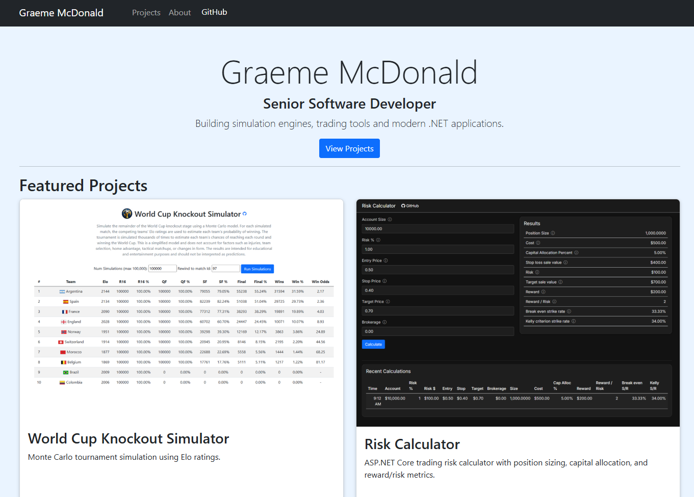

# Personal Portfolio Website

A personal portfolio website showcasing some of my software development projects, technical experience, and ongoing work.

The site is designed to provide an overview of my projects while also allowing each project to have a more detailed case study describing the problem, approach, implementation, and lessons learned.



## Features

* Data-driven project cards
* Individual project pages
* Project screenshots and images
* Links to GitHub repositories and live applications
* Markdown-based project documentation
* Responsive layout
* Clean, minimal design
* About section and personal information

## Technology

* **C#**
* **ASP.NET Core**
* **Razor Pages**
* **HTML / CSS**
* **Bootstrap**
* **Markdig** — Markdown-to-HTML rendering
* **JSON / C# data** for project information
* **GitHub** for source control and project repositories
* **Azure** for hosting

## Architecture

Projects are stored as structured data containing information such as:

* Project name
* Description
* Screenshot
* Technologies
* GitHub repository
* Live application

The project cards are generated dynamically from this data.

The project details page displays the project's GitHub README, rendered from Markdown using Markdig.

Each project has a unique id that is used to generate its details page.

For example:

```text
/Projects/Details/worldcup
```

This allows the same Razor Page template to be reused for every project rather than creating a separate Razor Page for each project.

## Projects

Some of the projects showcased on the site include:

### World Cup Knockout Simulator

A Monte Carlo simulation application that estimates the probability of teams reaching different stages of the FIFA World Cup knockout tournament using Elo ratings.

### Risk Calculator

A position sizing and risk management application for calculating trade size based on account size, risk percentage, entry price, stop loss, target price, and brokerage.

Additional projects will be added as they are completed.

## Purpose

This project is both a personal portfolio and an ongoing demonstration of software development skills.

The site itself is also treated as a project, with improvements being made as I learn new technologies and develop new applications.

## Author

**Graeme McDonald**

GitHub: [gmcdonald73](https://github.com/gmcdonald73)
